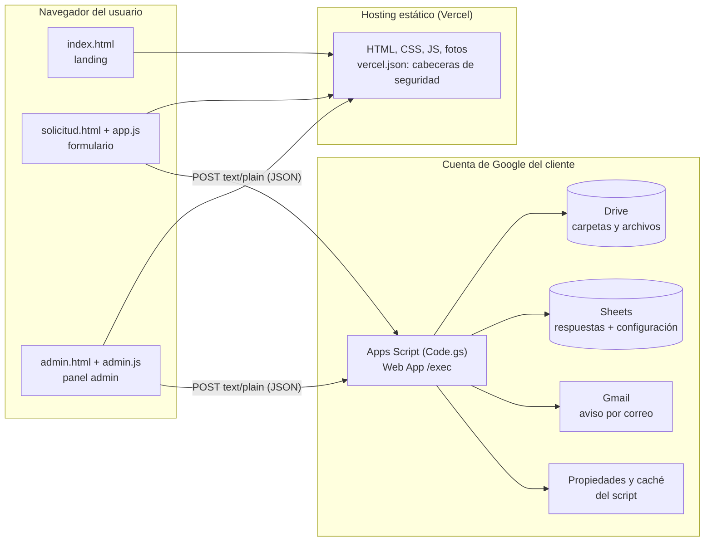
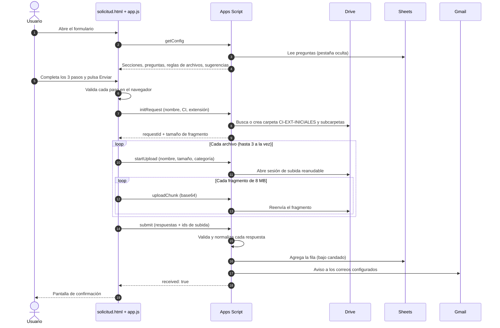
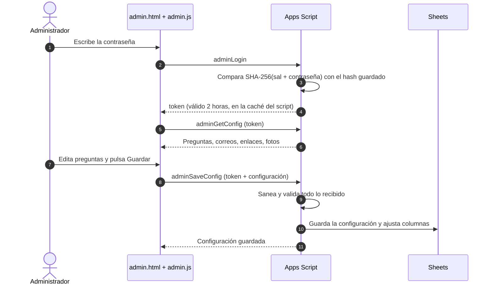

# Formulario de solicitudes — Academia Ejemplo

> **Plantilla genérica.** Este repositorio es una copia del proyecto original con todos los datos reales reemplazados por datos de ejemplo: nombre de la academia (`Academia Ejemplo`), correo (`contacto@ejemplo.com`), banner, URL del backend (`PEGAR_AQUI_LA_URL_DEL_WEB_APP` en `config.js`) e identificadores de Google. Para usarla:
>
> 1. Sigue la sección [Puesta en marcha](#5-puesta-en-marcha-paso-a-paso).
> 2. Cambia el nombre y el correo de contacto en `index.html`, `solicitud.html` y `admin.html`, y reemplaza `assets/banner.jpg` por tu propio banner (2000 × 492 px).
> 3. Ajusta en `apps-script/Code.gs`: `TIMEZONE`, `ROOT_FOLDER_NAME`, `SPREADSHEET_NAME`, `SHEET_NAME`, las listas de `SUGGESTIONS` y las preguntas de `DEFAULT_CONFIG`.
>
> **Licencias.** Las fotos de `assets/` son de terceros y tienen sus propias licencias Creative Commons: la autoría de cada una está en `assets/credits.json` y se muestra al pie de la página. El código de este repositorio todavía no tiene una licencia definida.

Sitio web con formulario de solicitudes para una academia de asesoría académica. El usuario completa un formulario de tres pasos y sube sus documentos, sin necesidad de una cuenta de Google. Los archivos quedan en una carpeta propia dentro de Google Drive, cada solicitud queda como una fila en Google Sheets y la academia recibe un correo de aviso. Un panel de administración permite cambiar preguntas, correos de aviso, contraseña y fotos del sitio sin tocar código.

Si algo falla, consulta **[FIX.md](FIX.md)**: reúne los errores conocidos, su causa y cómo resolverlos.

## Contenido

1. [Arquitectura](#1-arquitectura)
2. [Estructura del repositorio](#2-estructura-del-repositorio)
3. [Flujos](#3-flujos)
4. [Modelo de datos](#4-modelo-de-datos)
5. [Puesta en marcha paso a paso](#5-puesta-en-marcha-paso-a-paso)
6. [Operación diaria](#6-operación-diaria)
7. [Desarrollo y cambios de código](#7-desarrollo-y-cambios-de-código)
8. [Seguridad](#8-seguridad)
9. [Límites y cuotas](#9-límites-y-cuotas)
10. [Migrar a otra cuenta de Google](#10-migrar-a-otra-cuenta-de-google)

---

## 1. Arquitectura

El sistema tiene dos mitades que solo se comunican por HTTP: un **frontend estático** y un **backend en Google Apps Script**. No hay base de datos propia ni servidor que mantener: Google Drive y Google Sheets hacen de almacenamiento.



**Por qué esta separación**

- El frontend se publica en cualquier hosting estático. Cambiar de hosting no toca los datos.
- Los datos viven en la cuenta de Google del cliente: él es dueño de los archivos y de la hoja, no quien programó el sitio.
- Lo único que une las dos mitades es la **URL del Web App** (`SCRIPT_URL`, en `config.js`).

**Decisiones de diseño que conviene conocer**

| Decisión | Motivo |
|---|---|
| Las peticiones usan `Content-Type: text/plain` | Evita la petición previa CORS (`OPTIONS`), que Apps Script no responde. El cuerpo sigue siendo JSON. |
| Los archivos se suben por fragmentos de 8 MB | Una petición a Apps Script no puede pasar de ~50 MB, y se aceptan hasta 1 GB por campo. |
| Las preguntas viven en la hoja, no en el código | El cliente las edita desde el panel. El código solo trae las de fábrica. |
| El script se ejecuta como el dueño | Así los usuarios no necesitan cuenta de Google y los archivos ocupan el espacio del dueño. |
| Todo en una sola cuenta de Google | Un único dueño del script, de la carpeta y de la hoja evita problemas de permisos. |

## 2. Estructura del repositorio

| Ruta | Qué es |
|---|---|
| `index.html`, `site.css`, `site.js` | Landing: portada, servicios, carrusel de pasos, preguntas frecuentes. |
| `solicitud.html`, `styles.css`, `app.js` | Formulario público. Arma los campos con la configuración que le entrega el servidor. |
| `admin.html`, `admin.css`, `admin.js` | Panel de administración: editor de preguntas, correos, fotos y contraseña. |
| `config.js` | Única configuración del frontend: la URL del Web App. |
| `vercel.json`, `.vercelignore` | Cabeceras de seguridad (CSP y otras) y archivos que no se publican. |
| `assets/` | Fotos de la landing, banner y `credits.json` con la autoría de cada foto. |
| `apps-script/Code.gs` | Todo el backend. |
| `apps-script/appsscript.json` | Manifiesto: zona horaria, permisos (scopes) y modo del Web App. |
| `FIX.md` | Guía de errores y soluciones. |

El código de `apps-script/` **no se publica** en el hosting (lo excluye `.vercelignore`); se copia a mano al editor de Apps Script.

## 3. Flujos

### 3.1 Envío de una solicitud



Detalles que explican el comportamiento:

- `initRequest` crea la carpeta **antes** de subir nada. Si el mismo carnet vuelve a enviar, reutiliza su carpeta (`user:<CI>-<EXT>` en las propiedades del script).
- El primer fragmento de cada archivo se compara con la firma real del formato (PDF, JPG, PNG, WebP, HEIC, DOC, DOCX). Si no coincide, el servidor lo rechaza.
- Si se corta la conexión, `app.js` pregunta con `uploadStatus` cuántos bytes recibió Drive y reanuda. Hasta 4 reintentos con espera creciente.
- `submit` es idempotente: si la respuesta se pierde y el navegador reintenta, el servidor reconoce el `requestId` y no duplica la fila.
- El correo de aviso se envía **después** de guardar la fila. Si falla, la solicitud igual queda registrada.

### 3.2 Panel de administración



- La contraseña no se guarda: solo su hash con sal, en las propiedades del script.
- Tras 20 intentos fallidos el login se bloquea 15 minutos.
- Las fotos se cambian sin pasar por "Guardar": cada una se sube al instante (`adminUploadImage`) y puede restaurarse (`adminResetImage`).

### 3.3 Cómo llega una pregunta nueva al formulario

1. El administrador crea o edita una pregunta en el panel y guarda.
2. El servidor valida el tipo y el contenido, asigna una columna nueva en la hoja si hace falta y actualiza el encabezado.
3. La configuración se guarda en la celda `A1` de la pestaña oculta `Configuración`.
4. El formulario la recibe la próxima vez que llama a `getConfig` (la caché del servidor dura 10 minutos y se renueva al guardar).

### 3.4 Actualización de preguntas de fábrica

Si cambias el texto, el tipo o las opciones de una pregunta de fábrica en `Code.gs`, sube `CONFIG_VERSION`. La primera vez que el servidor lee la configuración, `migrateConfig_` actualiza esas preguntas ya guardadas, conservando si están activas u obligatorias, su sección y su orden. Los cambios hechos desde el panel a esas preguntas se reemplazan una vez.

## 4. Modelo de datos

### Google Drive

```
Carpeta principal/                       ROOT_FOLDER_ID
├── 1234567-LP-JP/                       una por persona: CI-extensión-iniciales
│   ├── Identidad/
│   ├── Guia/
│   ├── Avance actual/
│   └── Pago/                            solo si se activa el comprobante
└── Sitio - Imágenes/                    fotos del sitio subidas desde el panel
```

- Cada archivo se guarda con la fecha delante: `2026-10-25 - guia.pdf`.
- Los correos de aviso reciben **acceso de editor a toda la carpeta principal**. Por eso esa carpeta debe ser de uso exclusivo de este sistema.

### Google Sheets

| Pestaña | Contenido |
|---|---|
| `Respuestas` | Una fila por solicitud. Columnas: las preguntas en orden, y al final `ESTADO`, `DETALLE ESTADO`, `Carpeta del usuario`, `ID solicitud`. |
| `Configuración` (oculta) | Celda `A1`: JSON con secciones, preguntas, columnas y correos de aviso. No se edita a mano. |

Normalización antes de escribir:

| Dato | Se guarda como |
|---|---|
| Nombre | Sin espacios sobrantes y con mayúscula inicial en cada palabra |
| Celular | `+591` y 8 dígitos (acepta números internacionales con su `+código`) |
| Carnet | Mayúsculas, sin espacios |
| Ciudad y país | Solo letras. Si coincide con una sugerencia, con el nombre de la lista |
| Universidad | Libre. Si coincide con una sugerencia, con su nombre oficial |
| Fecha límite | Fecha real, no texto |
| Texto que empieza con `=`, `+`, `-` o `@` | Texto (con apóstrofo previo), nunca fórmula |

### Propiedades del script

| Propiedad | Uso |
|---|---|
| `ROOT_FOLDER_ID` | Carpeta principal de Drive |
| `SPREADSHEET_ID` | Hoja de respuestas |
| `ADMIN_SALT`, `ADMIN_PASSWORD_HASH` | Contraseña del panel (hash con sal) |
| `SITE_IMAGES` | Fotos del sitio cambiadas desde el panel |
| `user:<CI>-<EXT>` | ID de la carpeta de cada persona |

### Caché del script

| Clave | Para qué | Dura |
|---|---|---|
| `config-v2` | Configuración de preguntas | 10 min |
| `req:<id>` | Solicitud en curso (carpetas, CI) | 6 h |
| `up:<id>` | Archivo en subida | 6 h |
| `done:<id>` | Solicitud ya registrada (evita duplicados) | 6 h |
| `admin:<token>` | Sesión del panel | 2 h |
| `admin-fails` | Intentos fallidos del login | 15 min |

## 5. Puesta en marcha paso a paso

### 5.1 Backend (Apps Script)

Hazlo con la cuenta de Google que será dueña de los archivos.

1. Entra a <https://script.google.com> y crea un proyecto nuevo.
2. Pega el contenido de `apps-script/Code.gs` en `Código.gs`.
3. En **Configuración del proyecto**, activa "Mostrar el archivo de manifiesto appsscript.json" y reemplaza su contenido por `apps-script/appsscript.json`.
4. *(Opcional)* Para usar una hoja que ya existe, crea la propiedad `SPREADSHEET_ID` con su ID en **Propiedades del script** antes de seguir. Para usar una carpeta existente, `ROOT_FOLDER_ID`. Si no las creas, el código crea ambas.
5. En el editor elige la función `setup` y pulsa **Ejecutar**. Acepta los permisos. Si Google dice "app no verificada", pulsa **Avanzado** y continúa.
6. Abre el **Registro de ejecución**. Muestra el enlace de la carpeta, el de la hoja, el correo de aviso y la **contraseña inicial del panel**. Anótala: no se vuelve a mostrar (si la pierdes, ejecuta `resetAdminPassword`).
7. **Implementar > Nueva implementación > Aplicación web**:
   - Ejecutar como: **Yo**.
   - Quién tiene acceso: **Cualquier persona** (no "cualquier persona con cuenta de Google").
8. Copia la URL que termina en `/exec`.

Prueba rápida del backend:

```bash
curl -sL "https://script.google.com/macros/s/TU_ID/exec"
# Respuesta esperada: {"ok":true,"data":{"service":"form-solicitudes"}}
```

### 5.2 Frontend

1. En `config.js`, reemplaza `SCRIPT_URL` por la URL `/exec`.
2. Publica el repositorio en un hosting estático. Con Vercel:
   - Importa el repositorio en <https://vercel.com/new>.
   - Framework Preset: **Other**. Deja vacíos el comando de build, el directorio de salida y el de instalación.
   - Pulsa **Deploy**. Cada `push` a `main` publica solo.
3. Si Vercel te pide iniciar sesión para ver el sitio, desactiva **Deployment Protection** para producción en los ajustes del proyecto.

### 5.3 Primer arranque

1. Abre `/admin.html` e ingresa con la contraseña inicial. Cámbiala (mínimo 8 caracteres).
2. En **Correos de aviso** escribe los correos que deben enterarse de cada solicitud.
3. Haz un envío de prueba con un carnet inventado. Comprueba que aparezcan la carpeta en Drive, la fila en la hoja y el correo.
4. Borra los datos de prueba (carpeta y fila).

### 5.4 Dominio propio (opcional)

Registra el dominio a nombre del cliente. En el proyecto de Vercel, **Settings > Domains**, agrégalo y crea en tu proveedor de DNS los registros que Vercel indique. El `SCRIPT_URL` no cambia.

## 6. Operación diaria

| Quiero… | Dónde |
|---|---|
| Cambiar, agregar, reordenar o desactivar preguntas | Panel > tarjetas de preguntas. Se editan como en Google Forms. |
| Cambiar el tipo de una pregunta de fábrica | Panel. Solo dentro de su familia: respuesta corta ↔ párrafo; lista ↔ opción única ↔ casillas. Nombre, carnet, extensión y foto del carnet están bloqueados porque arman la carpeta. |
| Cambiar los correos de aviso | Panel > Correos de aviso, uno por línea. Quien se agrega recibe acceso de editor a la carpeta principal; quien se quita lo pierde. |
| Cambiar fotos del sitio | Panel > Fotos del sitio > Cambiar. Aplica al instante. "Restaurar" vuelve a la original. |
| Activar el comprobante de pago | Panel > pregunta "Comprobante de pago" > Activa en el formulario > Guardar. |
| Cambiar la contraseña | Panel > Cambiar contraseña. |
| Recuperar la contraseña | Editor de Apps Script > función `resetAdminPassword` > Ejecutar > Registro de ejecución. |
| Cambiar el estado de una solicitud | Hoja > columna `ESTADO`. |

## 7. Desarrollo y cambios de código

### Probar el frontend en local

```bash
python -m http.server 8765
# abre http://localhost:8765/
```

Hacen falta archivos servidos por HTTP: abrir los HTML con doble clic no sirve, porque el navegador bloquea las peticiones al backend.

### Cambiar el backend

1. Edita `apps-script/Code.gs`.
2. Cópialo completo al editor de Apps Script y guarda.
3. **Implementar > Gestionar implementaciones**, lápiz de la implementación existente, **Versión: Nueva versión**, **Implementar**. Si usas "Nueva implementación", la URL cambia.
4. Guardar el código **no** publica los cambios: el Web App sirve la última *versión* implementada.

### Constantes que se ajustan en `Code.gs`

| Constante | Qué controla |
|---|---|
| `FILE_RULES` | Extensiones, tamaño total y cantidad de archivos por campo. El formulario las recibe del servidor. |
| `SUGGESTIONS` | Listas de sugerencias (universidades, ciudades). |
| `DEFAULT_CONFIG` | Preguntas y secciones de fábrica. Al cambiarlas, sube `CONFIG_VERSION`. |
| `SITE_SLOTS` | Identificadores de las fotos editables. Deben coincidir con los `data-slot` de `index.html`. |
| `TIMEZONE`, `ROOT_FOLDER_NAME`, `SPREADSHEET_NAME`, `SHEET_NAME` | Zona horaria y nombres de lo que crea `setup()`. |

### Agregar una foto editable

1. En `index.html`, agrega `data-slot="id-nuevo"` y `data-slot-label="Nombre visible"` a la etiqueta ``.
2. Agrega `'id-nuevo'` a `SITE_SLOTS` en `Code.gs` y publica una nueva versión del backend.

### Cabeceras de seguridad

`vercel.json` define una política de contenido estricta: solo permite cargar scripts del propio sitio, estilos de Google Fonts, y conexiones al propio sitio y a Apps Script. Si agregas un servicio externo (analítica, mapas, vídeos), hay que añadirlo ahí o el navegador lo bloqueará. Ver [FIX.md](FIX.md#la-página-se-ve-sin-estilos-sin-fotos-o-sin-datos-en-producción).

## 8. Seguridad

| Riesgo | Cómo se controla |
|---|---|
| Credenciales en el frontend | No hay ninguna. `config.js` solo tiene la URL del Web App, que es pública por diseño. La contraseña del panel vive como hash con sal en las propiedades del script. |
| Archivos maliciosos | Lista de extensiones, tamaños máximos y comparación del primer fragmento con la firma real del formato. Los archivos nunca se ejecutan ni se publican. Drive los revisa con su antivirus al descargarlos. |
| Inyección de fórmulas en la hoja | El texto que empieza con `=`, `+`, `-` o `@` se guarda como texto. |
| XSS | El frontend no usa `innerHTML`. El correo de aviso escapa el contenido del usuario. La CSP bloquea scripts ajenos. |
| Recorrido de rutas | No aplica: Drive no usa rutas. Los nombres de archivo se limpian de barras y caracteres de control. |
| Inyección SQL | No aplica: no hay base de datos. |
| Fuerza bruta en el panel | Bloqueo de 15 minutos tras 20 intentos fallidos. |
| Spam | Campo trampa (*honeypot*) en el formulario. No hay captcha: ver límites. |
| Subir fotos al sitio | Solo imágenes JPG, PNG o WebP, verificadas por sus primeros bytes, de hasta 6 MB; solo esos archivos se comparten por enlace. |

Limitaciones conocidas:

- Un bot podría llenar el Drive enviando solicitudes. La defensa sería un captcha (por ejemplo Cloudflare Turnstile) verificado en el servidor.
- El bloqueo del login es global: alguien podría provocarlo para dejar fuera al administrador durante 15 minutos.
- `.doc` (formato antiguo de Word) puede contener macros. Si no lo necesitas, quítalo de `EXT_DOCS` en `Code.gs`.

## 9. Límites y cuotas

| Concepto | Valor |
|---|---|
| Fotografía de carnet | 2 archivos, 10 MB en total |
| Guía institucional y avance actual | 20 archivos y 1 GB en total, cada uno |
| Comprobante de pago | 1 archivo, 10 MB |
| Fotos del sitio | 6 MB por imagen (el navegador las reduce a 1600 px) |
| Preguntas | Máximo 60, con hasta 40 opciones cada una |
| Correos de aviso | Máximo 10 |
| Espacio | El de la cuenta de Google dueña del script (15 GB gratis, compartidos con Gmail y Fotos) |
| Correos de Apps Script | Cuota diaria de Google según el tipo de cuenta (en cuentas personales, del orden de 100 destinatarios por día) |
| Tiempo por ejecución | 6 minutos, suficiente para cada petición individual |

## 10. Migrar a otra cuenta de Google

Los archivos ocupan el espacio de la cuenta dueña del script, así que compartir una carpeta no basta: el script debe vivir en la cuenta destino.

1. Con la cuenta destino, repite 5.1. Para conservar el historial, crea antes `SPREADSHEET_ID` con la hoja existente (la cuenta destino debe tener acceso de editor a ella).
2. En `config.js`, cambia `SCRIPT_URL` por la nueva URL `/exec` y publica. Es el único cambio en el sitio.
3. Entra al panel con la contraseña nueva, cambia la contraseña y revisa los correos de aviso (la lista viaja con la hoja).
4. Archiva la implementación vieja (**Gestionar implementaciones > Archivar**) para que no siga escribiendo en la cuenta anterior.
5. Las carpetas de usuarios anteriores siguen donde estaban. Las filas viejas de la hoja conservan sus enlaces; las nuevas apuntan a la carpeta de la cuenta destino.
6. Las fotos del sitio cambiadas desde el panel viven en el Drive de la cuenta anterior. Hay que volver a subirlas, o se usan las de `assets/`.
