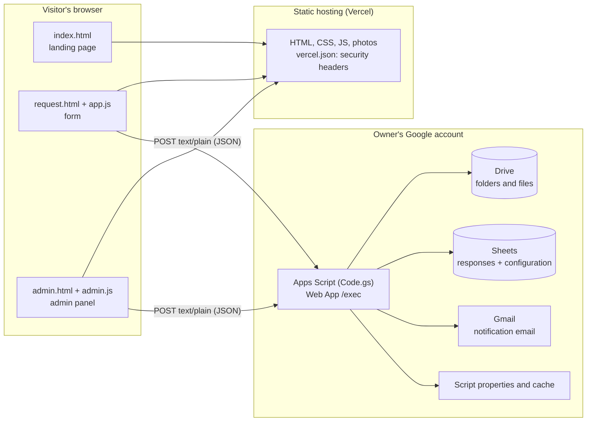
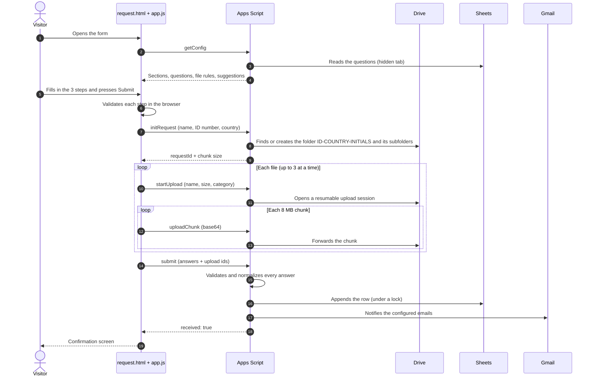
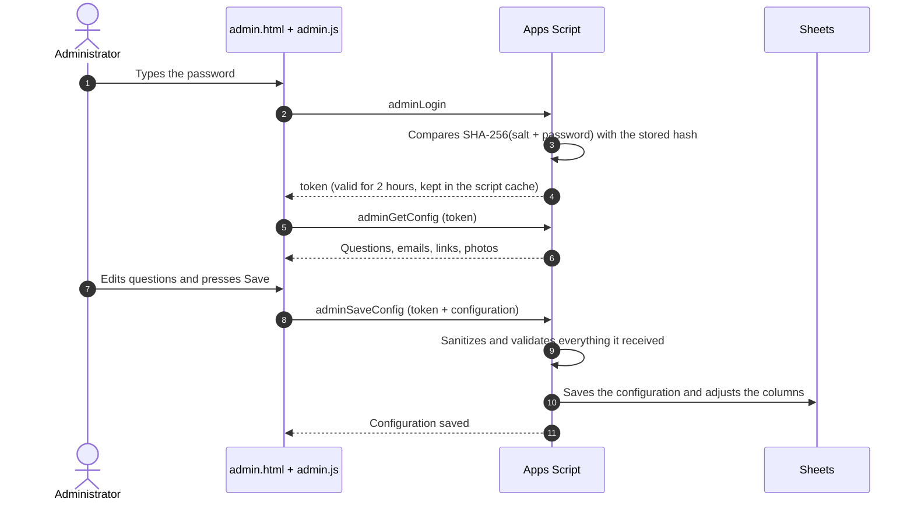

# FormForge — build your own form with HTML and Google Apps Script

A complete, working example of a **self-hosted request form** that stores everything in your own Google account:

- A static website (plain HTML, CSS and JavaScript) with a multi-step form.
- Files uploaded by visitors go to **Google Drive**, into one folder per person.
- Every submission becomes a row in **Google Sheets** and triggers an email notification.
- An **admin panel** lets a non-technical owner edit questions, notification emails, photos and the password, without touching code.
- The backend is a single **Google Apps Script** file. There is no server to run and no database to host.

Visitors do not need a Google account. The owner of the Google account owns all the data.

It is meant to be read and learned from as much as to be copied: the code is small, commented, and the docs explain the flows and the failure modes.

> **Generic template.** All real data of the original project was replaced with sample data: the brand (`Example Academy`), the email (`contact@example.com`), the banner, the Web App URL (`PASTE_THE_WEB_APP_URL_HERE` in `config.js`) and every Google identifier. The sample business is an academic coaching and editing service, only so the form has realistic fields.

## Contents

1. [What you will learn](#1-what-you-will-learn)
2. [Architecture](#2-architecture)
3. [Repository structure](#3-repository-structure)
4. [Flows](#4-flows)
5. [Data model](#5-data-model)
6. [Quick start](#6-quick-start)
7. [Day-to-day operation](#7-day-to-day-operation)
8. [Adapting it to your own form](#8-adapting-it-to-your-own-form)
9. [Development and code changes](#9-development-and-code-changes)
10. [Security](#10-security)
11. [Limits and quotas](#11-limits-and-quotas)
12. [Moving to another Google account](#12-moving-to-another-google-account)
13. [License](#13-license)

When something fails, read **[FIX.md](FIX.md)**: it lists the known errors, their causes and how to fix them.

---

## 1. What you will learn

| Topic | Where to look |
|---|---|
| Using Apps Script as a JSON API behind a `doGet` / `doPost` Web App | `apps-script/Code.gs`, `ACTIONS` and `doPost` |
| Calling a Web App from a static page without the CORS preflight (`text/plain` trick) | `api()` in `app.js` |
| Uploading files of up to 1 GB through Apps Script (resumable Drive sessions, 8 MB chunks, retries and resume) | `startUpload`, `uploadChunk`, `uploadStatus`; `uploadFile()` in `app.js` |
| Working with `DriveApp`, `SpreadsheetApp`, `MailApp`, `PropertiesService`, `CacheService` and `LockService` | `Code.gs` |
| Building a form from a configuration stored in a sheet, and an editor for it (drag and drop, types, options) | `admin.js`, `sanitizeConfig_` |
| Validating and cleaning data on the server, never only in the browser | `validateQuestion_` and its helpers |
| Defending against malicious files, formula injection and XSS | [Security](#10-security) |
| Deploying the static site with strict security headers (CSP) | `vercel.json` |

## 2. Architecture

Two halves that only talk over HTTP: a **static frontend** and a **Google Apps Script backend**. Google Drive and Google Sheets are the storage.



**Why it is split this way**

- The frontend can be published on any static host. Changing hosts never touches the data.
- The data lives in the Google account of the owner of the business, not of whoever built the site.
- The only link between the two halves is the **Web App URL** (`SCRIPT_URL` in `config.js`).

**Design decisions worth knowing**

| Decision | Reason |
|---|---|
| Requests use `Content-Type: text/plain` | It avoids the CORS preflight (`OPTIONS`) request, which Apps Script does not answer. The body is still JSON. |
| Files are uploaded in 8 MB chunks | A request to Apps Script cannot exceed ~50 MB, and some fields accept up to 1 GB. |
| Questions live in the sheet, not in the code | The owner edits them from the panel. The code only ships the factory ones. |
| The script runs as its owner | Visitors do not need an account and the files use the owner's storage. |
| Everything in one Google account | One owner for the script, the folder and the sheet avoids permission problems. |

## 3. Repository structure

| Path | What it is |
|---|---|
| `index.html`, `site.css`, `site.js` | Landing page: cover, services, steps carousel, FAQ. |
| `request.html`, `styles.css`, `app.js` | The public form. It builds its fields from the configuration the server returns. |
| `admin.html`, `admin.css`, `admin.js` | Admin panel: question editor, emails, photos and password. |
| `config.js` | The only frontend setting: the Web App URL (`window.APP_CONFIG.SCRIPT_URL`). |
| `vercel.json`, `.vercelignore` | Security headers (CSP and others) and files that are not published. |
| `assets/` | Landing photos, the banner and `credits.json` with the author of each photo. |
| `apps-script/Code.gs` | The whole backend. |
| `apps-script/appsscript.json` | Manifest: time zone, permissions (scopes) and Web App mode. |
| `FIX.md` | Troubleshooting guide. |

The `apps-script/` folder is **not** published by the host (`.vercelignore` excludes it): you copy it by hand into the Apps Script editor.

## 4. Flows

### 4.1 Submitting a request



Details that explain the behavior:

- `initRequest` creates the folder **before** anything is uploaded. If the same ID submits again, its folder is reused (`user:<ID>-<COUNTRY>` in the script properties).
- The first chunk of every file is compared with the real signature of its format (PDF, JPG, PNG, WebP, HEIC, DOC, DOCX). If it does not match, the server rejects the file.
- If the connection drops, `app.js` asks Drive with `uploadStatus` how many bytes it received and resumes. Up to 4 retries with growing waits.
- `submit` is idempotent: if the response is lost and the browser retries, the server recognizes the `requestId` and does not duplicate the row.
- The notification email is sent **after** saving the row. If it fails, the request is still recorded.

### 4.2 Admin panel



- The password is never stored: only its salted hash, in the script properties.
- After 20 failed attempts the login is blocked for 15 minutes.
- Photos are changed without "Save": each one is uploaded immediately (`adminUploadImage`) and can be restored (`adminResetImage`).

### 4.3 How a new question reaches the form

1. The administrator creates or edits a question in the panel and saves.
2. The server validates the type and content, assigns a new column in the sheet if needed and updates the header.
3. The configuration is stored in cell `A1` of the hidden `Config` tab.
4. The form receives it the next time it calls `getConfig` (the server cache lasts 10 minutes and is refreshed on save).

### 4.4 Updating factory questions

If you change the text, type or options of a factory question in `Code.gs`, bump `CONFIG_VERSION`. The first time the server reads the configuration, `migrateConfig_` updates those stored questions, keeping whether they are active or required, their section and their order. Changes made from the panel to those questions are replaced once.

## 5. Data model

### Google Drive

```
Main folder/                             ROOT_FOLDER_ID
├── 1234567-BO-JP/                       one per person: ID number-country-initials
│   ├── Identity/
│   ├── Guide/
│   ├── Current draft/
│   └── Payment/                         only if the proof of payment is enabled
└── Site - Images/                       site photos uploaded from the panel
```

- Each file is saved with the date in front: `2026-10-25 - guide.pdf`.
- Notification emails receive **editor access to the whole main folder**. That is why the folder must be used only by this system.

### Google Sheets

| Tab | Contents |
|---|---|
| `Responses` | One row per request. Columns: the questions in order, then `STATUS`, `STATUS DETAIL`, `User folder`, `Request ID`. |
| `Config` (hidden) | Cell `A1`: JSON with sections, questions, columns and notification emails. Do not edit it by hand. |

Normalization before writing:

| Datum | Saved as |
|---|---|
| Name | No extra spaces and a capital initial in every word |
| Phone | `+<country code><number>`. A number typed with `+` is kept; a local number gets `PHONE_COUNTRY_CODE` |
| ID number | Uppercase, no spaces |
| City and country | Letters only. If it matches a suggestion, with the spelling of the list |
| University | Free text. If it matches a suggestion, with its official spelling |
| Deadline | A real date, not text |
| Text starting with `=`, `+`, `-` or `@` | Text (with a leading apostrophe), never a formula |

### Script properties

| Property | Use |
|---|---|
| `ROOT_FOLDER_ID` | Main Drive folder |
| `SPREADSHEET_ID` | Responses spreadsheet |
| `ADMIN_SALT`, `ADMIN_PASSWORD_HASH` | Panel password (salted hash) |
| `SITE_IMAGES` | Site photos changed from the panel |
| `user:<ID>-<COUNTRY>` | ID of each person's folder |

### Script cache

| Key | Purpose | Lasts |
|---|---|---|
| `config-v2` | Question configuration | 10 min |
| `req:<id>` | Request in progress (folders, ID) | 6 h |
| `up:<id>` | File being uploaded | 6 h |
| `done:<id>` | Request already recorded (prevents duplicates) | 6 h |
| `admin:<token>` | Panel session | 2 h |
| `admin-fails` | Failed login attempts | 15 min |

## 6. Quick start

### 6.1 Backend (Apps Script)

Do it with the Google account that will own the files.

1. Go to <https://script.google.com> and create a new project.
2. Paste the contents of `apps-script/Code.gs` into `Code.gs`.
3. In **Project settings**, enable "Show appsscript.json manifest file in editor" and replace its contents with `apps-script/appsscript.json`.
4. *(Optional)* To use an existing spreadsheet, create the property `SPREADSHEET_ID` with its ID in **Script properties** before continuing. For an existing folder, `ROOT_FOLDER_ID`. If you do not create them, the code creates both.
5. In the editor choose the function `setup` and press **Run**. Accept the permissions. If Google says "app not verified", press **Advanced** and continue.
6. Open the **Execution log**. It shows the folder link, the sheet link, the notification email and the **initial panel password**. Write it down: it is not shown again (if you lose it, run `resetAdminPassword`).
7. **Deploy > New deployment > Web app**:
   - Execute as: **Me**.
   - Who has access: **Anyone** (not "Anyone with a Google account").
8. Copy the URL that ends in `/exec`.

Quick test of the backend:

```bash
curl -sL "https://script.google.com/macros/s/YOUR_ID/exec"
# Expected: {"ok":true,"data":{"service":"request-form"}}
```

### 6.2 Frontend

1. In `config.js`, replace `SCRIPT_URL` with the `/exec` URL.
2. Publish the repository on a static host. With Vercel:
   - Import the repository at <https://vercel.com/new>.
   - Framework Preset: **Other**. Leave the build command, output directory and install command empty.
   - Press **Deploy**. Every `push` to `main` publishes on its own.
3. If Vercel asks you to sign in to see the site, turn off **Deployment Protection** for production in the project settings.

### 6.3 First run

1. Open `/admin.html` and sign in with the initial password. Change it (minimum 8 characters).
2. In **Notification emails** type the emails that should hear about every request.
3. Make a test submission with a made-up ID number. Check that the folder appears in Drive, the row in the sheet and the email.
4. Delete the test data (folder and row).

### 6.4 Custom domain (optional)

Register the domain in the name of the business owner. In the Vercel project, **Settings > Domains**, add it and create at your DNS provider the records Vercel tells you. `SCRIPT_URL` does not change.

## 7. Day-to-day operation

| I want to... | Where |
|---|---|
| Change, add, reorder or disable questions | Panel > question cards. They are edited like in Google Forms. |
| Change the type of a factory question | Panel. Only within its family: short answer ↔ paragraph; dropdown ↔ single choice ↔ checkboxes. Full name, ID number, ID country and ID photo are locked because they build the folder. |
| Change the notification emails | Panel > Notification emails, one per line. Whoever is added gets editor access to the main folder; whoever is removed loses it. |
| Change site photos | Panel > Site photos > Change. It applies instantly. "Restore" goes back to the original. |
| Enable the proof of payment | Panel > "Proof of payment" question > Active in the form > Save. |
| Change the password | Panel > Change password. |
| Recover the password | Apps Script editor > function `resetAdminPassword` > Run > Execution log. |
| Change the status of a request | Sheet > `STATUS` column. |

## 8. Adapting it to your own form

1. **Your questions.** Edit `DEFAULT_CONFIG` in `Code.gs` (ids, labels, help, options, sections) or, after the first run, edit them from the panel. Question types: `text`, `textarea`, `number`, `date`, `select`, `radio`, `checkbox`, plus the special ones `tel`, `idnumber`, `pages`, `place` and `file`.
2. **File fields.** Each `file` question has a `category`. Define its extensions, total size and number of files in `FILE_RULES`, and its Drive subfolder name in `SUBFOLDERS`.
3. **Folder naming.** The folder is built in `findOrCreateUserFolder_` from the ID number, the ID country and the initials of the name. If your form identifies people differently, change that function and the locked questions (`fullName`, `idNumber`, `idExt`) together with the places where `initRequest` and `submit` read them.
4. **Localization.** These defaults are Bolivian and easy to change:
   - `TIMEZONE` in `Code.gs` and `timeZone` in `appsscript.json`.
   - `PHONE_COUNTRY_CODE` (added to local phone numbers).
   - The country codes in the `idExt` question and the lists in `SUGGESTIONS`.
   - The Spanish name particles in `titleCase_` (`de`, `del`, `la`...).
   - Every visible text: the HTML pages, `app.js`, `admin.js` and the messages in `Code.gs`.
5. **Branding.** Replace the banner (`assets/banner.jpg`, 2000 × 492 px), the colors at the top of `site.css` and `styles.css`, and the copy in `index.html`.
6. **Names of what `setup()` creates.** `ROOT_FOLDER_NAME`, `SPREADSHEET_NAME`, `SHEET_NAME`, `CONFIG_SHEET_NAME`.

### Constants you may adjust in `Code.gs`

| Constant | What it controls |
|---|---|
| `FILE_RULES` | Extensions, total size and number of files per field. The form receives them from the server. |
| `SUGGESTIONS` | Suggestion lists (universities, cities). |
| `DEFAULT_CONFIG` | Factory questions and sections. When you change them, bump `CONFIG_VERSION`. |
| `SITE_SLOTS` | Identifiers of the editable photos. They must match the `data-slot` attributes in `index.html`. |
| `CHUNK_SIZE`, `MAX_QUESTIONS`, `MAX_OPTIONS`, `ADMIN_MAX_FAILS`, TTL constants | Technical limits. |

### Adding an editable photo

1. In `index.html`, add `data-slot="new-id"` and `data-slot-label="Visible name"` to the `` tag.
2. Add `'new-id'` to `SITE_SLOTS` in `Code.gs` and publish a new version of the backend.

## 9. Development and code changes

### Test the frontend locally

```bash
python -m http.server 8765
# open http://localhost:8765/
```

The files must be served over HTTP: opening the HTML files by double click does not work, because the browser blocks the requests to the backend.

### Change the backend

1. Edit `apps-script/Code.gs`.
2. Copy it whole into the Apps Script editor and save.
3. **Deploy > Manage deployments**, pencil on the existing deployment, **Version: New version**, **Deploy**. If you use "New deployment", the URL changes.
4. Saving the code does **not** publish the changes: the Web App serves the last *deployed version*.

### Security headers

`vercel.json` defines a strict content policy: it only lets the page load scripts from the site itself, styles from Google Fonts, and connections to the site itself and to Apps Script. If you add an external service (analytics, maps, videos), you must add it there or the browser will block it. See [FIX.md](FIX.md#the-page-has-no-styles-photos-or-data-in-production).

## 10. Security

| Risk | How it is handled |
|---|---|
| Credentials in the frontend | There are none. `config.js` only holds the Web App URL, which is public by design. The panel password lives as a salted hash in the script properties. |
| Malicious files | Extension list, maximum sizes and comparison of the first chunk with the real format signature. Files are never executed or published. Drive scans them with its antivirus when downloaded. |
| Formula injection in the sheet | Text starting with `=`, `+`, `-` or `@` is saved as text. |
| XSS | The frontend does not use `innerHTML`. The notification email escapes user content. The CSP blocks foreign scripts. |
| Path traversal | Not applicable: Drive does not use paths. File names are stripped of slashes and control characters. |
| SQL injection | Not applicable: there is no database. |
| Brute force on the panel | 15-minute block after 20 failed attempts. |
| Spam | A honeypot field in the form. There is no captcha: see the limits below. |
| Photo uploads to the site | Only JPG, PNG or WebP images, checked by their first bytes, up to 6 MB; only those files are shared by link. |

Known limitations:

- A bot could fill the Drive by sending requests. The defense would be a captcha (for example Cloudflare Turnstile) verified on the server.
- The login block is global: someone could trigger it to lock the administrator out for 15 minutes.
- `.doc` (the old Word format) can contain macros. If you do not need it, remove it from `EXT_DOCS` in `Code.gs`.

## 11. Limits and quotas

| Item | Value |
|---|---|
| ID photo | 2 files, 10 MB in total |
| Institutional guide and current draft | 20 files and 1 GB in total, each |
| Proof of payment | 1 file, 10 MB |
| Site photos | 6 MB per image (the browser shrinks them to 1600 px) |
| Questions | Maximum 60, with up to 40 options each |
| Notification emails | Maximum 10 |
| Storage | That of the Google account that owns the script (15 GB free, shared with Gmail and Photos) |
| Apps Script emails | Daily Google quota depending on the account type (about 100 recipients a day on personal accounts) |
| Time per execution | 6 minutes, enough for each individual request |

## 12. Moving to another Google account

The files use the storage of the account that owns the script, so sharing a folder is not enough: the script must live in the destination account.

1. With the destination account, repeat 6.1. To keep the history, first create `SPREADSHEET_ID` with the existing sheet (the destination account needs editor access to it).
2. In `config.js`, change `SCRIPT_URL` to the new `/exec` URL and publish. It is the only change in the site.
3. Sign in to the panel with the new password, change it and review the notification emails (the list travels with the sheet).
4. Archive the old deployment (**Manage deployments > Archive**) so it stops writing to the previous account.
5. Folders of previous users stay where they were. Old rows in the sheet keep their links; new ones point to the destination account.
6. Site photos changed from the panel live in the previous account's Drive. Upload them again, or the ones in `assets/` are used.

## 13. License

The **code** of this repository is released under the [MIT License](LICENSE): you can use, copy, modify and distribute it, including in commercial projects, as long as you keep the copyright notice.

The **photographs** in `assets/` are third-party works under their own Creative Commons licenses. The author and license of each one are in `assets/credits.json` and are shown in the page footer. Some of them require attribution or share-alike. Replace them with your own photos before using this template for a real business.
